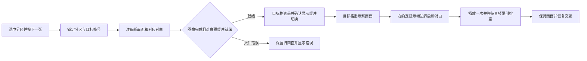

# 分区交互漫画与人物语音同步方案评估

评估日期：2026-10-20。本文件是方案评估，不表示已经实现。参考用户提供的 `C:/Users/yhh/Downloads/ACA420交互漫画作品逻辑说明.docx`，结合当前 liantiao 双板工程进行分析；本次没有改动 HDL、模型、约束和下载码流。

## 结论与目标体验

可行。建议沿用 HX 读取 SD 卡、处理图片并输出 HDMI，ACA 接收按键/语音操作、处理数字音效。新增一个漫画模式，在 640×480 画面中显示 2×2 四格，每格约 320×240（画边框后有效区域略小）。

先选中一格，再按“下一张”：该格出现转场，其他三格保持原样；新画面出现后，通过 HDMI 播放该画面对应的人物对白一次。对白播放完停住画面，等待下一次操作。这里的同步是图片切换事件与对白起播同步；若要嘴型逐帧匹配，需要另加动画帧和时间轴，不能仅用一张静态图实现。

第一版建议支持四格独立帧号，但同一时刻只执行一个切换、一条对白。图格内容独立，不要求四格同时播放各自的声音，也不需要复制四套图片处理流水线。

## 已保存当前版本

完整快照路径：`E:/anlo_project/liantiao_备份_漫画开发前_20261020_132403`。

原工程 8308 个文件已全部复制并逐文件核对 SHA256，包括 RTL、模型、约束、TD 工程、下载码流、工具、验证结果和历史资料。快照内 `SNAPSHOT_SHA256.json` 记录文件清单及哈希，`备份说明.txt` 说明恢复方式。

这是可恢复文件快照。TD 工程和部分模型引用含绝对路径，若直接在备份目录编译，需先处理路径；完整恢复时复制回原 `E:/anlo_project/liantiao`。备份目录不在原工程内部，避免后续备份递归套入自身。

## 与现有实现的差异

| 项目 | 当前版本 | 漫画模式需要新增 |
|---|---|---|
| 图片组织 | 整屏切换图片 | 四格各自维护帧号、当前选区和资源映射 |
| 转场 | 整屏旧图遮黑、换缓冲、新图揭示 | 只在目标矩形内应用遮罩，其他区域保持像素不变 |
| WAV | 最多 8 首目录扫描列表，曲尾循环 | 按漫画画面查找对白，播一次，有完成事件 |
| 播放控制 | 音乐和语音交互模式互斥 | 漫画事件统一调度画面、对白和识别许可 |
| 同步 | 图片和曲目没有绑定关系 | 图片准备、显示确认和音频预缓冲握手后起播 |
| 输入 | 按键、整句上一张/下一张 | 选择目标格；在漫画模式解释相关操作 |

当前 `transition_fx.v` 实际上是旧画面淡出/遮盖至黑，再揭示新画面。附件中的 fade 公式是新旧两幅图同时读取并混合的交叉淡化，两者实现成本不同。建议第一版复用现有的经黑转场与擦除观感，限制到目标格内；真正的新旧图交叉淡化另作扩展。

## 建议的同步流程

不应在按键瞬间直接播放对白：SD 卡读图和 WAV 头解析耗时有变化，容易出现人物还没显示就先说话。建议起播点设为目标格完整揭示后的第一个显示帧边界；以后可用剧情配置让对白在揭示开始时进入。两个策略都要等待图像和对白准备好。

需要在视频、SD 和音频时钟域之间传递带事务编号的请求/应答，防止旧画面的音频完成事件被误认为新任务。图像错误、音频格式错误、取消和卡丢失也必须结束或撤销同一事务。

音频 EOF 只表示文件读完，不等于声音播完；完成信号必须等 FIFO 及串行输出尾部排空。现有 `wav_sector_reader.v` 会在 EOF 后回到文件头循环，需要改成可选单次播放模式并保留原音乐模式的循环行为。用于提前缓存的 PCM FIFO 也要将“允许读卡预取”和“允许开始输出”分开。

当前 FIFO 为 4096 个立体声采样帧，48 kHz 下约 85 ms。预缓存只能减少起播延迟，不能覆盖整句对白；需要给持续读卡保留优先级，并实测卡带宽。若在转场前完成图像载入，播放对白时通常更容易保障音频读卡。

FPGA 可以把起播事件对齐到显示帧与音频采样边界，但 HDMI 显示器/电视可能引入额外音画延迟；最终观感需要实测，必要时增加可调的对白起播偏移。

## 四格独立画面的实现选择

不建议第一步就在像素扫描时同时读四路图库并做两路交叉淡化，HX 当前 LUT 约 86%、BRAM 约 86%，复杂多路读缓存可能放不下或难以通过时序。

建议评估“共享读图器＋整屏前后台缓冲＋目标格局部更新”：复制当前合成画面到后台，只把目标格写成新内容；后台完成后，遮盖目标格、在显示帧边界安全换缓冲，再揭示新格。其他三格在两个缓冲中相同，视觉上不发生转场。复制操作要使用共享 SDRAM 仲裁、突发读写及缓存，并验证不会影响前台显示，不能假设现有帧写入器已支持矩形地址写入。

这条路线需要新增矩形写入/画面复制调度、边界坐标和局部转场，但可以共享一个读卡器、一个缩放器和一个显示输出。是否能容纳新增逻辑，应在最小原型综合、布局布线后判断。

也可先做低风险体验样机：电脑预先生成每个剧情步骤的整屏四格 BMP，保留未变化的三格，只对目标格加转场并绑定对白。这能验证观看体验，但它是预设剧情序列，**不能替代任意选择四格、各自独立推进的完整实现**。

## 图片对白如何绑定

每条漫画事件至少包含 `分区号、帧号、图片资源ID、对白资源ID、转场类型、起播时机`。素材在电脑上预处理，生成 FPGA 可读取的固定长度场景表，避免在 FPGA 内加入 JSON 解析器。

例如第 2 格从第 1 帧进入第 2 帧时，对应 `格2/帧2 → 图片C0202 → 对白V0202 → 擦除 → 揭示完成后播放一次`。没有对白的帧用空资源ID，正常转场但不发声。资源ID必须由确定的索引或文件名映射得到，不能依赖 FAT 目录扫描顺序碰巧一致。

第一版可继续使用已支持的 24 位 BMP 输入和 48 kHz/16 位 PCM WAV，离线把图裁好到每格尺寸，节省在线缩放计算。人物对白用单声道即可，播放时复制到左右声道。无需在 FPGA 上实时合成人声，配音提前录好或在电脑生成后放入 SD 卡。

当前文件列表和索引上限主要面向 8 张图片/8 首音乐。四格各多帧很容易超过上限，必须连同资源表、计数位宽、文件系统缓存及测试一起扩展，不能仅在卡里多放文件。

## 语音交互与人物对白的冲突

现有设计进入语音识别模式后会静音音乐。漫画对白不能直接套用这一开关，否则“用口令切图”可能导致对白一直没有声音。

建议第一版先用按键选区和推进。之后接入语音：识别到命令后暂停识别，允许播放人物对白；对白结束后留一段安静保护时间，再重新取得识别许可，避免音箱里的“下一张”被当作观众口令。用户选择打断对白时，应取消当前事务、清空旧音频，再进入新画面。

按键“点一下”和触摸“点某个格子”需要区分。目前只有按键/语音输入，HDMI 显示器本身不能把点击坐标传回 FPGA；触摸需另接触摸控制器及通信接口。第一版建议用边框标识选中格，一键轮换选区、一键推进，具体按键与旧模式通过漫画模式上下文区分。

## 存储与平台假设核实

本机官方 `EG4S20数据手册.pdf` 第 4～6 页（PDF页码）确认 EG4S20BG256 具有 2M×32bit、即 8 MiB 的内嵌 SDRAM；ACA 工程的器件配置也为 EG4S20BG256。因此附件关于 SDRAM 容量有数据手册依据。

此前仅根据 ACA 剩余 15 块 BRAM 推断“不适合存整图”的表述不完整：15 块 BRAM 约 17 KiB，但这与 8 MiB SDRAM 是两类独立资源。ACA 硬件上有扩展图像存储的可能；当前 ACA RTL 尚未接入 SDRAM 控制器、图片读卡和显示输出，所以不能视为现成可用的漫画显示系统。

数据手册的 200 MHz、800 MB/s 是器件标称上限，不是当前工程实测带宽。HX 当前 SDRAM 控制参数以约 41.67 MHz 时钟周期配置，实际可用吞吐还受刷新、读写切换和仲裁影响。SDRAM PHY 原语也不等同于完整的图库管理或应用层读写仲裁。

| 估算对象 | 容量 |
|---|---:|
| 一格 320×240 RGB565 | 150 KiB |
| 四格共一屏 RGB565 | 600 KiB |
| 两个整屏 RGB565 缓冲 | 约 1.17 MiB |
| 当前 HX 32bit/像素存储，一屏 | 约 1.17 MiB |
| 当前 HX 32bit/像素存储，两个整屏 | 约 2.34 MiB |
| 48 kHz/16bit 单声道人声 | 每秒约 96 kB，10 秒约 0.96 MB |

容量上有余地不代表读写调度已经满足要求。第一版不建议为了省存储立即把现有 32bit 帧存格式改成 RGB565，以免扩大修改面。对白长文件仍放 SD 卡并流式读取。

## 建议实施与验收顺序

1. 四格静态布局、选中框和素材绑定：确认选择哪格，只推进哪格。
2. 局部帧更新和转场：逐像素验证另外三格不变、边框无越界、缓冲切换无撕裂；检查连续按键和取消。
3. 单次对白与同步门控：覆盖不同长度、空对白、格式错误、欠载、EOF 尾部排空和文件不存在。
4. 接入现有 ACA 音效并验证 HDMI；用画面闪标与已知测试音测实际延迟。
5. 综合与布局布线检查 HX 增量资源，再做真实双板、实卡和长时间连续切换。
6. 最后加入语音推进、对白期间识别抑制和可选触摸；多格同时转场、混音和口型动画单独评估。

推荐先做四格、单次一格切换、单条配音的完整小样，保留当前浏览/音乐功能为原模式。相比直接扩展更多音效，这一方向能更明确地展示观众操作、画面反馈与声音叙事的配合。
